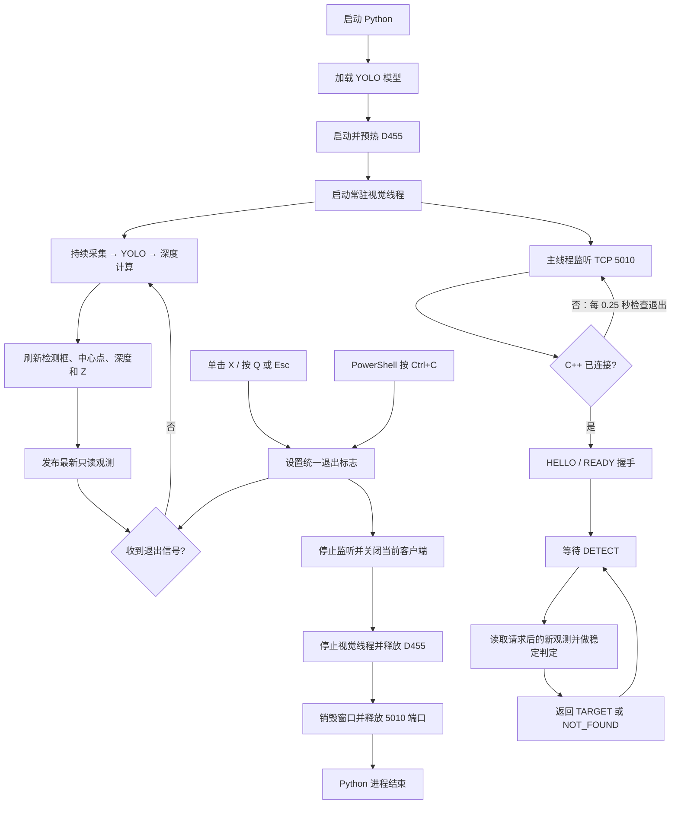

# YOLOv8 + D455 + ROKAE 视觉引导控制说明

Python 视觉服务持续获取 RealSense 彩色/对齐深度帧并运行 YOLOv8，只检测类别 14
（当前模型中的 bottle）；`vision_pick.exe` 仍采用“机械臂按需请求坐标”的工作方式。
收到请求后，服务只使用请求之后的新观测。目标必须连续稳定至少 0.5 秒且至少包含
3 个有效推理帧，服务才会对稳定样本的 XYZ 取平均并返回给 C++ 控制程序。

## 文件说明

- `example/cpp/vision_pick.cpp`：机械臂状态检查、视觉通信、坐标换算和运动流程。
- `example/yolo_realsense_server.py`：D455 取图、YOLO 推理、深度计算和 TCP 服务。
- `example/vision_requirements.txt`：Python 视觉服务使用的主要依赖版本。

原来的 `D:\yolov8\yolov8\realsense_tea_v8.py` 使用连续发送三个二进制浮点数的
旧通信方式，不能直接配合当前 `vision_pick.cpp`。联调时应运行本项目中的
`example\yolo_realsense_server.py`。

## 安全默认行为

- 不带 `--execute` 运行 `vision_pick.exe` 时，不创建机器人对象、不连接控制器、
  不发送运动指令。
- `--vision-test` 只测试视觉 TCP 通信，不连接机械臂，并允许使用 MOCK 模拟数据。
- 实机执行拒绝 MOCK 数据，且必须由操作人员在终端准确输入 `RUN`。
- 实机程序每轮只执行一次识别、校准、下探和返回；一轮结束后必须由操作人员
  明确输入 `RE` 才会开始下一轮，不会自动连续下探。
- 二次校准在相机 X、Y、Z 三个方向上的修正量分别不得超过 50 mm。
- 每个笛卡尔目标位姿都要求法兰在基座坐标系中的 Z 坐标大于 0。
- 急停、安全门停止或掉电时禁止自动回撤，等待人工处理。
- 普通下探失败且控制器仍上电、空闲时，程序尝试沿原路径退回下探前位姿，
  然后返回 HOME。

## 当前固定参数

- 机器人地址：`192.168.2.160`
- 默认视觉服务器地址：`192.168.2.100:5010`
- HOME 法兰位姿：`[-0.198162, 0.342077, 0.540341, -3.042894284, 0.090216069, 0.210748507]`
  `[X,Y,Z]` 使用米，`[A,B,C]` 使用弧度；采用笛卡尔目标 `MoveJ` 返回。
- 第一次对准目标：相机坐标 `(0, 0, 300)` mm
- 二次校准限制：`|ΔX|、|ΔY|、|ΔZ| ≤ 50 mm`
- 下探方向：RealSense 彩色相机光学坐标系 `+Z`
- 下探距离：200 mm
- D455 原始深度流：`424×240 @ 30 FPS`，用于避开 300 mm 附近的近距离盲区
- RGB 彩色流：`640×480 @ 30 FPS`，用于 YOLO 检测；深度随后对齐到彩色坐标系
- 到位后的图像稳定等待时间：800 ms
- YOLO 目标类别：`class 14`（当前模型中的 `bottle`）
- 视觉稳定条件：连续至少 0.5 秒且至少 3 个有效推理帧
- 二次识别容错：一次稳定窗口内最多允许 2 帧漏检；漏检帧不计入有效帧数，
  第 3 帧漏检会清空本窗口并重新累计。首次识别不允许漏检。
- 稳定性门限：相邻帧中心漂移不超过 35 px，深度漂移不超过 50 mm
- 稳定检测最长等待：15 秒
- 最低法兰高度：基座坐标系 `Z > 0`
- 返回观察位非实时 MoveJ 速度：`100`，`zone=0`（由 SDK 换算为关节速度档并精确停车）
- 首次移动到目标上方 MoveL 速度：`200 mm/s`
- 二次短距离精校 MoveL 速度：`100 mm/s`
- 下探 MoveL 速度：`200 mm/s`
- 正常及故障回撤 MoveL 速度：`200 mm/s`
- 所有当前运动的转弯区：`zone=0 (fine)`，识别点与下探端点均精确停车

## 启动视觉服务

本机已验证的 Python 解释器为：

```powershell
D:\code\anaconda\envs\v8\python.exe
```

连接 D455、关闭 RealSense Viewer 后，在项目根目录运行：

```powershell
D:\code\anaconda\envs\v8\python.exe -B example\yolo_realsense_server.py --show
```

`--show` 会在 RealSense 启动后立即打开常驻预览。无论当前是否有 C++ 客户端连接、
是否收到 `DETECT`，Python 都会持续采集、执行 YOLO 并刷新检测框。红色实心圆是
检测框几何中心；画面左上角持续显示当前状态、中心深度簇的有效点数、当前 Z、
稳定帧数和累计稳定时间。常驻预览只发布只读观测，不会主动向 C++ 发送坐标；
C++ 仍然只在原有两次 `DETECT` 请求中各接收一次稳定相机坐标。每次 `DETECT`
同时携带当前法兰 XYZABC，Python 会用该位姿实时生成 `end_to_base`，与
`HAND_IN_EYE_MATRIX` 相乘后打印目标的基座坐标，便于对照调试。

### 当前运行流程



### 正常退出视觉服务

使用 `--show` 时，有三种退出方式：

- 单击预览窗口右上角的 **X**；
- 让预览窗口处于当前焦点后按 **Q** 或 **Esc**；
- 在启动 Python 的 PowerShell 中按 **Ctrl+C**。

前两种方式会把窗口操作转换成整个服务的退出信号。Python 随后停止接受新连接、
结束当前 C++ 连接、停止持续推理线程、释放 D455、销毁窗口并释放 5010 端口，
不会在下一帧重新创建窗口。Socket 内部的 0.25 秒短超时只用于检查退出信号，
不会因为客户端空闲而主动断开连接。

状态栏可能显示：

- `TARGET_LOST`：当前帧没有目标框。
- `INVALID_DEPTH`：有目标框，但中心邻域没有足够的有效深度点。
- `CENTER_JUMP`：相邻有效帧中心偏移超过 35 px。
- `Z_JUMP`：相邻有效帧 Z 变化超过 50 mm。
- `STABILIZING`：请求期间正在累计稳定帧和时间。
- `STABLE`：本次请求已经满足稳定条件。

默认参数等价于：

```powershell
D:\code\anaconda\envs\v8\python.exe -B example\yolo_realsense_server.py `
  --target-class 14 --stable-seconds 0.5 --stable-min-frames 3 `
  --stability-timeout 15 --show
```

程序按以下顺序寻找模型：

1. `example\models\best.pt`
2. `D:\yolov8\yolov8\runs\detect\train4\weights\best.pt`

也可以明确指定模型和推理设备：

```powershell
D:\code\anaconda\envs\v8\python.exe -B example\yolo_realsense_server.py `
  --model D:\你的模型目录\best.pt --device 0 --show
```

`--device 0` 表示使用第一块 CUDA 显卡；使用 CPU 时可改为 `--device cpu`。
RealSense Viewer 与 Python 程序不能同时占用同一台 D455。

程序启动后会输出实际设备型号、序列号、固件、USB 连接类型，以及最终生效的
深度和彩色流配置。应看到深度为 `424x240@30`、彩色为 `640x480@30`；如果连接的
不是 D455，程序会输出警告，但不会擅自中止视觉服务。

## 不连接机械臂的测试方法

### 1. Python 逻辑自测

此测试不加载模型，也不启动相机：

```powershell
D:\code\anaconda\envs\v8\python.exe -B example\yolo_realsense_server.py --self-test
```

看到 `SELF_TEST_OK` 表示目标选择、请求解析和响应格式测试通过。

### 2. MOCK 通信测试

先在一个终端启动只接收一个客户端的模拟视觉服务：

```powershell
D:\code\anaconda\envs\v8\python.exe -B example\yolo_realsense_server.py `
  --mock --once --host 127.0.0.1 --port 5010
```

再在另一个终端运行 C++ 视觉通信测试：

```powershell
out\build\x64-Debug\example\vision_pick.exe --vision-test `
  --vision-ip 127.0.0.1 --vision-port 5010
```

该过程不会创建机器人对象。看到 `validation=PASS` 表示 C++ 与 Python 的握手、
请求编号和 XYZ 数据解析正确。

### 3. 真实 D455 视觉测试

先启动非 MOCK 的视觉服务，再运行：

```powershell
out\build\x64-Debug\example\vision_pick.exe --vision-test `
  --vision-ip 127.0.0.1 --vision-port 5010
```

若 C++ 和 Python 分别运行在两台电脑上，应把 `127.0.0.1` 改成视觉电脑在机器人
网络中的实际 IPv4 地址。

## 实机循环执行

只有在真实 D455 视觉测试通过、急停可用且工作区无人无障碍物时，才运行：

```powershell
out\build\x64-Debug\example\vision_pick.exe --execute `
  --vision-ip 192.168.2.100 --vision-port 5010
```

程序会等待操作人员输入 `RUN`，之后才创建机器人对象并连接控制器。第一次返回
观察位时还会打印逆解得到的六个目标关节角；必须与 Robot Assist 核对并输入
`RUN_HOME`，程序才会发送首次非实时 MoveJ。单轮流程为：

1. 对固定 HOME 法兰位姿
   `[-0.198162, 0.342077, 0.540341, -3.042894284, 0.090216069, 0.210748507]`
   求一次六轴逆解，通过软限位和正解误差检查后缓存；该结果用于运动前的安全预检和
   到位核对。确认后发送固定笛卡尔目标 `MoveJCommand`，由控制器内部规划关节轨迹。
   后续循环复用同一预检结果。
2. 请求第一次识别，选择三维距离相机最近的有效目标。
3. 平移到目标前约 300 mm，同时在理想平行安装假设下保持 C、令 A=±π、B=0，
   近似使相机 +Z 对准基座 -Z。
4. 等待 800 ms，再请求一张帧号和时间戳均更新的图像。
5. 读取第二次 XYZ，与 `(0, 0, 300)` mm 比较并执行二次校准。
6. 若二次修正任一轴超过 50 mm，则取消下探并返回 HOME。
7. 沿相机光学坐标系 `+Z` 移动相机/TCP 200 mm。
8. 沿相同直线路径回撤到下探前位姿。
9. 返回 HOME，本轮结束并等待操作人员输入 `RE` 或退出指令。

一轮正常完成或安全终止后，程序保持机器人和视觉连接并等待终端输入：

- 输入 `RE`：重新从 request 1 开始执行一轮完整流程；
- 输入 `EXIT` 或 `Q`：显式断开机器人连接并正常结束程序；
- 其他输入：不运动，继续等待有效指令。

## 非实时 MoveJ 与速度参数

返回观察位使用非实时 `MoveJCommand`，目标为固定观察位笛卡尔位姿，参数为
`speed=100、zone=0`。`executeCommand()` 异步下发指令，随后由 `waitRobot()` 等待
控制器完成运动并回到空闲状态。轨迹由控制器内部规划，不需要上位机实时网络或
实时关节状态通道；到位后仍等待 800 ms 才允许 YOLO 取图。

其余非实时运动命令的 `speed` 对 MoveL 表示末端最大线速度，单位为 `mm/s`。
SDK 的 `zone` 表示最大转弯区半径，
有效范围约为 0～200 mm：`zone=0` 是 fine 精确停车，非零值可让连续轨迹在中间点
附近过渡。要产生连续过渡，通常需要把多条同类型命令一次性放进同一个
`executeCommand()` 列表；当前程序逐条下发并等待 `idle`，所以各段都会停车。

本流程在首次识别位、二次识别位和下探端点都必须停稳，因此 MoveL 继续使用
`zone=0`。MoveJ/MoveL 决定路径在关节空间还是笛卡尔空间插补，轨迹速度如何随时间
加速和减速由控制器内部规划。HOME 返回不再调用 `RtMotionController<6>::MoveJ()`，
也不直接调用 `JointMotionGenerator`。

关节空间插补只避免强制法兰沿笛卡尔直线扫过茶树，不等于自动碰撞规划。运行前仍要
确认六轴连杆从当前位置到观察位的完整扫掠空间、软限位和线缆状态。

## Windows 控制台编码

程序启动时会主动把控制台输入、输出代码页设置为 UTF-8；同时会检测 SDK
`error_code.message()` 是否为有效 UTF-8。如果不是，则按 Windows 系统 ANSI 代码页
转换为 UTF-8。`-50101` 和 `-50102` 还会分别输出固定中文含义，避免 SDK 原始文本
乱码影响诊断。

如果当前 PowerShell 会话中的其他程序仍然乱码，可以在该窗口执行：

```powershell
chcp 65001
[Console]::InputEncoding = [System.Text.UTF8Encoding]::new()
[Console]::OutputEncoding = [System.Text.UTF8Encoding]::new()
$OutputEncoding = [System.Text.UTF8Encoding]::new()
```

这些设置只影响当前 PowerShell 窗口，不会修改系统区域设置。

## 坐标关系

RealSense 输出的是彩色相机光学坐标系坐标：

- X：图像向右
- Y：图像向下
- Z：沿镜头光轴向前

`vision_pick.cpp` 中手眼矩阵按“法兰到相机”解释，使用的转换链为：

```text
目标基座坐标 = 基座到法兰 × 法兰到相机 × 目标相机坐标
```

Python 只负责调试打印上述转换结果；实际机械臂运动仍由 `vision_pick.cpp`
根据相机坐标和当前法兰位姿计算。

首次移动使用近似姿态方案：保持法兰 C 不变来近似保持相机 +X 的水平投影方向，
令法兰 A=±π、B=0，使相机 +Z 近似对准基座 -Z。当前仍按移动前的相机旋转
计算平移量，因此旋转引起的相机光心位移尚未补偿；二次识别仍受各轴 50 mm
安全限制，超限时取消下探并返回 HOME。

## 后续改进

- 通过 `hand_in_eye()` 精确反算法兰 XYZABC。
- 补偿相机相对法兰的平移偏置。

## 目标丢失和故障处理

- 没有检测框：返回 `TARGET_LOST`，机械臂不下探并返回 HOME。
- 检测到目标但深度无效：返回 `INVALID_DEPTH`，机械臂不下探并返回 HOME。
- 相邻有效帧中心偏移超过 35 px：返回 `CENTER_JUMP`，机械臂不下探并返回 HOME。
- 相邻有效帧 Z 变化超过 50 mm：返回 `Z_JUMP`，机械臂不下探并返回 HOME。
- 目标在 15 秒内不能持续稳定 0.5 秒且没有更具体原因：返回
  `UNSTABLE_TARGET`，机械臂不下探并返回 HOME。
- 第二次识别不是更新后的帧：拒绝下探并返回 HOME。
- 二次修正任一轴超过 50 mm：拒绝下探并返回 HOME。
- 下探普通失败：停止当前运动；若仍上电且控制器空闲，则尝试原路回撤。
- 急停、安全门停止、掉电或控制器非空闲：不发送自动回撤指令。
